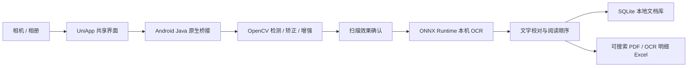

# 智拍 SnapScan · 离线智能扫描仪

面向 Android 的本机文档扫描项目：拍照或选图，裁出纸面、透视矫正与图像增强，进行中英文 OCR，再校对、检索并导出可搜索 PDF。

**当前版本：`0.2.3-local` / versionCode `203`。** Android 8 及以上，手机发布构建面向 ARM64。模型、页面和处理组件随 APK 内置，首次启动无需下载模型；应用不声明 `INTERNET` 权限，不需要电脑后端、热点或云服务。源码提供开发与研究入口，模型权重、APK、原始照片及标注不随本仓库提交；完整构建条件见[构建与资源准备](docs/GITHUB_BUILD.md)。

## 功能

| 模块 | 已实现能力 |
| --- | --- |
| 图像输入 | 系统相机拍照、相册选图，本机文件读取 |
| 纸面扫描 | 边缘与纸色区域候选、四角手动调整、透视矫正、背景裁切；小区域误裁保护 |
| 图像增强 | 原色、净白、黑白模式；先预览确认，也可只保存扫描图 |
| 离线 OCR | PP-OCR 检测、方向分类与文字识别；ONNX Runtime CPU 推理 |
| 文字校对 | 图文对照、逐行修改、草稿保存、同行阅读顺序整理 |
| 本地文档库 | SQLite 保存扫描图、文字框及修订信息，历史重开与文字检索 |
| 文件导出 | 保留扫描图外观的可搜索 PDF、重排文本 PDF、OCR 明细 Excel |

可搜索 PDF 使用扫描图与文字层叠加，保留原图外观；校对改变文字层，不会改写图中印刷字形。Excel 输出识别文本与坐标等明细，尚未恢复表格单元格结构。

## 使用流程

1. 拍照或选图，检查自动纸面边界。
2. 必要时手动调整四角，选择增强模式并应用。
3. 确认扫描效果后提取文字，或直接保存扫描图。
4. 在图文对照页校对，保存到本机历史，导出 PDF / Excel。

边界不可靠时会提示手动调整或保留整图；保留整图不等于已完成去背景。版本 `0.2.3` 修复了课本正文漏行、文字行裁剪混入邻行、相邻正文错误合并，以及部分内部小表格被误当成整页的问题。旧记录中未识别出的文字，需要使用原图重新扫描才能补全。

## 架构与技术栈



- **手机端**：Java、Android WebView、UniApp / Vue，OpenCV `4.12.0`、ONNX Runtime Android `1.23.2`、SQLite、PDFBox Android。
- **算法与开发后端**：Python、OpenCV、RapidOCR `1.4.4`、FastAPI；保留电脑端用于算法对照和联调。
- **训练与验证**：PyTorch、CTC 识别头微调、ONNX 导出、CER 评测、Python / JavaScript 测试与 Android 仪器测试。

独立 APK 通过 `SnapScanNative` 调用本机算法，不监听 HTTP 端口。WebView 中的 `appassets.androidplatform.net` 仅作为本地资源拦截地址。可在 [AndroidManifest.xml](mobile/android-local/app/src/main/AndroidManifest.xml) 查看权限声明。旧局域网客户端及 FastAPI 路径仍保留在源码中，其运行方式与当前独立 APK 不同。

## Codex 辅助开发实践

本项目由作者使用 **Codex 辅助完成扫描算法、OCR 接入及 Android 应用开发**。开发过程围绕具体需求、截图和失败样例组织上下文，按功能拆解任务，结合日志、测试输出及实际扫描结果多轮修正。

实践覆盖图像处理链路、模型微调与导出、本机接口集成、漏字与阅读顺序问题排查、打包和回归验证。项目保留明确的指标范围与失败案例，以实际测试和产物核验判断功能是否完成。

## 模型与评测

识别模型 `rec_head_v1` 基于 PP-OCRv4：冻结主干，仅微调 CTC 识别头的 **801,625 个参数**，训练 20 轮，使用 **1,272 行训练样本、307 行内部验证样本**。检测与方向分类沿用预训练权重；`0.2.3` 的漏字修复针对后处理链路，没有再次训练模型。

| 验证范围 | 已记录结果 | 指标含义 |
| --- | --- | --- |
| 307 行内部文字行验证 | CER `1.0973% → 0.5949%` | 识别头微调结果，不代表整页照片准确率 |
| 26 张完整标注旧课本整页 | CER `49.994% → 1.657%` | 已知失败数据上的修复回归，不是独立泛化成绩 |
| 28 张新图分组评测 | 10 张课本、10 张课件、6 张英文小票、1 张中文火车票、1 张中文发票 | 区域与全文分开计分；首次独立结果和后续同集修复回归分开记录 |
| Android 工程验证 | 25 项 Android 15 模拟器断网测试、2 项 JVM 单元测试通过 | 已有版本的验证记录；不能代替目标手机实测 |

CER 为 `(替换 + 删除 + 插入) / 真值字符数`，越低越好。新集包含数字页面和扫描件，课本、课件直接 OCR 的部分指标出现退化；追加误裁保护后的同集结果也不能算作新的独立测试成绩。8 张新票据未自动确认纸面四角，其 OCR 成绩不能证明自动裁纸成功率。完整范围与失败分析见[课本漏字修复与三类新数据评测](reports/课本漏字修复与三类新数据评测.md)。

**目标手机 iQOO Neo8 Pro / Android 15 尚未完成该版本实机验收。** 当前不承诺手机端耗时、内存占用或通用识别成功率。公开仓库提供算法、评测和测试代码；真实照片回归依赖未公开的本地图片、标注及测试资产，不能仅凭源码完整重现。

## 目录

```text
mobile/android-local/   Android 原生离线容器与构建脚本
mobile/uniapp/          共享扫描、校对、历史界面
mobile/prepare_local_models.py   本地模型校验与 Android 资源准备
backend/               电脑端算法与 FastAPI 对照实现
training/              识别头微调、数据准备及导出代码
evaluation/            CER、扫描与导出验收代码
reports/               关键修复与评测说明
docs/                  构建和项目文档
```

## 开发与构建

```bash
git clone https://github.com/lazysheeplikemoney1/snapscan-offline.git
cd snapscan-offline
```

当前 Android 构建脚本针对 Windows，依赖 Python、JDK 17、Gradle 8.10.2、Android SDK 35、HBuilderX 的 UniApp 编译器，以及已就位的模型与本地签名。首次准备构建工具和字体需要联网，安装后的 APK 推理不需要网络。

**克隆源码后需先完成[构建与资源准备](docs/GITHUB_BUILD.md)**：现有脚本保留开发机工具位置、模型哈希及开发证书核验，新机器须按文档配置，不能直接视为一键构建。没有权重时可阅读代码、运行不依赖真实图像资产的逻辑测试；完整 OCR 与 Android 集成测试需要补齐相应资源。

电脑端单独运行方式：

```bash
python -m venv .venv-backend
# 激活 .venv-backend 后执行
python -m pip install -r backend/requirements.txt
# 先按构建文档准备本地模型，再启动
python -m uvicorn app.main:app --app-dir backend --host 127.0.0.1 --port 8000
```

在 `http://127.0.0.1:8000/api/health` 检查 `ocr.ready` 与模型信息；模型缺失或校验失败时应显示不可用。该服务用于开发对照，手机独立 APK 无需启动它。

## 当前边界

- 适合清晰印刷课本、课件、小票及部分其他票据；自动裁切与关键字段仍需预览校对。
- 未实现通用语义文档分割、弯曲页面展平、复杂多栏与完整表格结构恢复、手写体或数学公式专用识别。
- 严重模糊、反光、屏幕摩尔纹与纸张出框可能导致漏字或误裁；增强不能恢复未拍到的信息，也不保证每张图的 OCR 更准确。
- 本地搜索使用 SQLite 字面子串匹配；FTS5、离线翻译和 NCNN 加速尚未接入。

相关说明：[手机完全离线架构](reports/手机完全离线升级说明.md) · [文本同行排版与适用范围](reports/文本同行排版修复与适用范围.md) · [屏幕翻拍检测修复](reports/屏幕翻拍检测修复说明.md)。第三方组件的版权与许可文件保留在 [Android 资源目录](mobile/android-local/app/src/main/assets/licenses)。
