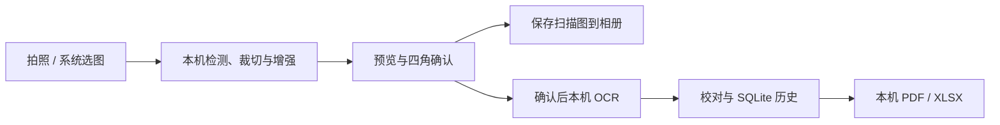

# SnapScan 手机完全离线升级（2026-10-16）

> 公开版本说明：保留原评测结论与指标；原始图片、全文标注、安装包及详细运行证据保存在本地，本页已移除这些资料的下载链接。

本文保留为0.2.0首次独立离线实现的历史记录。当前版本为0.2.1，见[屏幕翻拍检测修复说明](屏幕翻拍检测修复说明.md)。0.2.0的APK、报告及设备产物已归档于 `releases/versions/0.2.0-local-code200/`；下文无版本路径的报告现由最新验收更新，查看旧数值请使用归档。

## 交付与变化

安装文件：`releases/SnapScan-offline-local.apk`，版本 `0.2.0-local` / code200。目标手机为 iQOO Neo8 Pro、Android 15；最低 API26，手机包只包含 arm64-v8a，模拟器使用另行构建的 x86_64 调试包。使用原开发签名，旧包保留。安装方法见 `docs/手机安装APK指引.md`。

本轮将后端所需能力移植到 Android 进程内：OpenCV 负责检测、透视变换、纸面遮罩和增强；ONNX Runtime 运行 det/cls/rec；SQLite 存储图片引用、原始识别框、校对文本和修订号；本机生成 PDF/XLSX。原来的扫描确认和文字提取流程继续保留。

没有 Python 服务、监听端口或电脑地址设置。页面使用 App 内的虚拟 HTTPS 资源域名与异步 Java 接口；APK 无 INTERNET 权限。首次启动时模型已经在包中，模型校验/加载失败直接报错，不自动下载或改用远程识别。

## 用户反馈的小票

旧算法主要寻找闭合四边形，该照片中的纸张上下触及画面边缘，又有木纹、反光和第二张纸，完整外沿候选被拒绝。本轮增加纸面颜色区域候选，识别低色度的可见纸面，将外部背景从透视裁切结果中清理为白色。

- 此图裁切结果为 414×885 像素；木纹背景被移除，票面文字保留，并可继续 OCR。
- 前端显示纸张出框及可能包含重叠纸张的提醒。自动结果按相连纸面整体估计，可能带入下层纸条；只要最上面一张时仍需手动调整四角。
- 不恢复画外内容，不补写看不清的文字；没有将该用户样例上传第三方或并入锁定测试集。
- 该变化为检测/分割算法改进，并非训练出新的语义分割模型。识别继续使用已经训练的 `rec_head_v1`。

代码位置：`backend/app/services/doc_detect.py`、`mobile/android-local/app/src/main/java/com/snapscan/offline/ScanProcessor.java`。Python 对照图见 `output/scan/receipt-feedback-comparison.jpg`；Android 实际运行产物及检查记录另存 `output/scan/android-device/`。

## 数据与文件一致性

规范化 EXIF 方向，大图解码采样控制到最长边不超过4096。四角、预览、OCR 框和历史图使用同一像素空间；历史保存实际识别 Mat 的 PNG，修复了直接复制大 PNG 导致图像尺寸与 OCR 坐标不一致的问题。

预览不新增 OCR 历史。确认识别后才保存图片、文本、模型与原始框；校对事务检查修订号，旧修订保存/导出返回冲突。保版式 PDF 保留扫描底图，并按框叠加不可见可搜索文字；XLSX 用字符串单元格保存 OCR 明细，包括前导零和等号开头文本。

PDF 内嵌中文字体，补齐模型字符。校对中超出内置字形的字符，文本版明确显示方框并说明，原 Unicode 仍通过文字映射和原文附件保留；保版式 PDF 的扫描底图不受影响。

拍照通过系统相机和 FileProvider 返回完整照片，选图通过系统文件选择器；保存图片通过 MediaStore，打开/分享导出文件通过系统文件授权。相机期间 Activity 重建后可恢复已拍照片，由用户继续确认，不自动执行 OCR。

## 验证证据

- Python 后端回归：116项通过。
- 共享前端回归：64项通过，包括本机模式不回退局域网、拍照接线、图片确认、校对和导出。
- 模型资源准备测试：1项通过。
- 字体生成与字形唯一性测试：3项通过。
- Java 主机算法检查：61项通过，仅作为移植对照，不冒充 Android 执行结果。
- Java 主机 OCR 对照：DEV036的55行文字与 Python 输出一致；此结果不是通用准确率，也不是手机速度测试。
- Android15的16项真实仪器测试全部通过，另有2项URL边界单测通过。断网状态、设备产物和源码快照：`reports/android_local_device_verification.json`。
- APK 编译、签名、ZIP对齐：`reports/android_local_build_verification.json`。
- APK 模型/字典/字体/H5一致性、无测试图片泄漏、无网络权限及64位库16KB ELF对齐：`reports/android_local_package_acceptance.json`。
- Android实际导出的PDF经Poppler渲染检查；底图像素与扫描PNG完全一致，中文文字可提取，Excel98行与保存修订对应。Unicode样例的字形、方框说明和原文保留已检查：`reports/android_local_export_acceptance.json`。

Android 模拟器与 iQOO 真机是不同验证范围。本轮没有连接目标手机，不能据此给出其识别耗时、电量、峰值内存或相机兼容结论。真实 Android 执行与导出结果以对应报告中的最终测试状态为准。

## 保留的边界

旧电脑历史不会自动迁移到手机。手机搜索采用 SQLite 字面子串匹配；Excel 是 OCR 行明细，尚无单元格恢复。FTS5、语义分割模型、翻译、NCNN和INT8性能对比均不在本轮完成范围。严重卷曲、遮挡、同色背景等仍可能需要手动框选，不能以此样例成功宣称所有场景已解决。

本机运行库参考：[ONNX Runtime Android](https://onnxruntime.ai/docs/install/)、[OpenCV Android](https://opencv.org/opencv4android-usage-models/)、[PDFBox Android](https://github.com/TomRoush/PdfBox-Android)。具体依赖版本、字体来源及许可证随源代码和 APK 资产记录。
